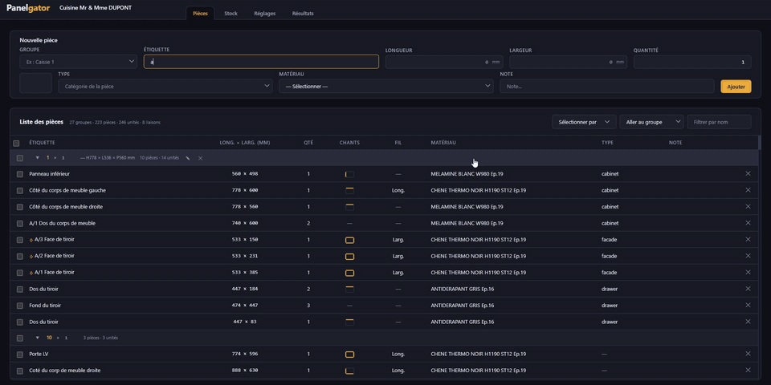
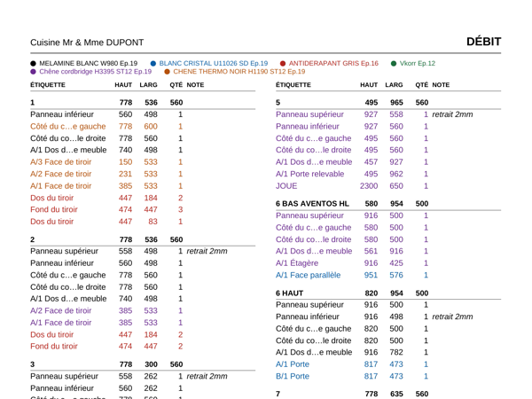
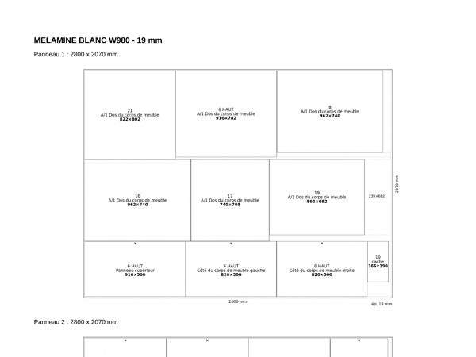
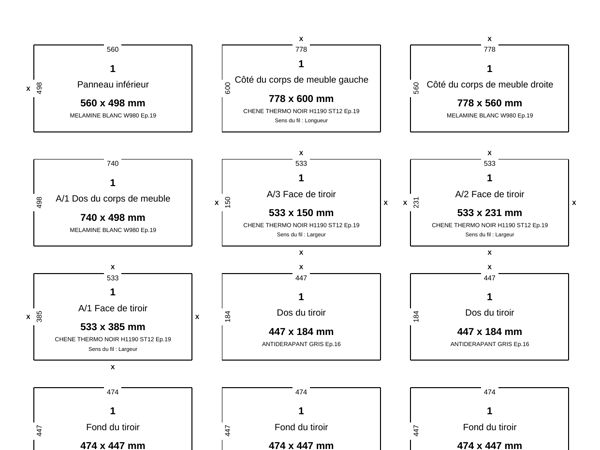

  

  <b>Calepinage automatique et feuilles de débit</b> pour l'agencement.

  
  

  <a href="https://github.com/Pixvi/panelgator-releases/releases/latest/download/Panelgator-Setup.exe"><b>⬇&nbsp;&nbsp;Télécharger pour Windows</b></a>

  

## Installation

1. Télécharger [`Panelgator-Setup.exe`](https://github.com/Pixvi/panelgator-releases/releases/latest/download/Panelgator-Setup.exe) et le lancer.
2. Windows affiche **« Windows a protégé votre ordinateur »** : cliquer sur **Informations
   complémentaires**, puis **Exécuter quand même**.
3. Panelgator s'installe et se lance. Le raccourci est dans le menu Démarrer.

> [!NOTE]
> L'avertissement apparaît parce que l'installeur n'est pas signé par un certificat payant. Il ne
> vient que de ce dépôt. En cas de doute, ne téléchargez Panelgator que depuis la page
> [Releases](https://github.com/Pixvi/panelgator-releases/releases).

**Mises à jour** : automatiques. Panelgator télécharge la nouvelle version en arrière-plan et
propose de l'installer dès qu'elle est prête. Si on répond « Plus tard », il la repropose au
lancement suivant.

## Fonctionnalités

| | |
|---|---|
| **Import** | Fichiers `.BXF2` de Blum e-Services et `.CSV` : pas de double saisie. |
| **Stock** | Plusieurs matériaux par projet : matière, épaisseur, panneaux entiers, chutes ou tablettes, stock limité ou illimité. |
| **Chants** | Chants par côté, assignés à l'import, épaisseur déduite, longueurs totales calculées. |
| **Fil** | Sens du fil par matériau et par pièce, pièces liées pour garder la continuité du veinage. |
| **Coupe** | Lame, rééquerrage, sens de coupe selon la machine : scie à panneau, scie à format ou CNC. |
| **Export** | Feuille de débit, plans de coupe et étiquettes en `.PDF`, `.DXF` et `.CSV`. |

## Exports

<table>
  <tr>
    <td align="center"> <b>Feuille de débit</b></td>
    <td align="center"> <b>Plans de coupe</b></td>
    <td align="center"> <b>Étiquettes</b></td>
  </tr>
</table>

## Bon à savoir

- **Windows uniquement**.
- Les projets sont des fichiers `.pnlg` : on les enregistre où on veut et on peut se les échanger.
- Aucune donnée ne quitte le PC, à part la vérification des mises à jour sur GitHub.

## À propos

Panelgator est **gratuit** et partagé tel quel, sans garantie ni support.

Vincent · Pixvi

