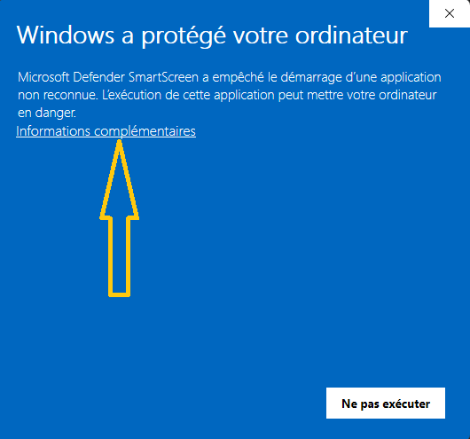
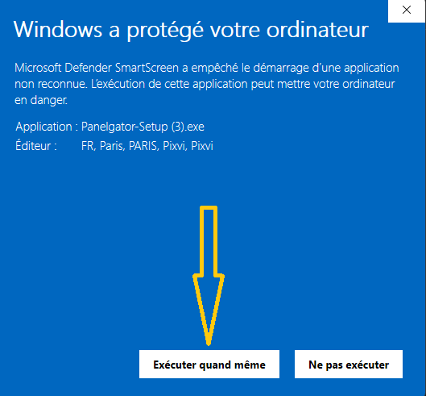

# Installation

Panelgator est disponible pour **Windows 10 et 11 (64 bits)**. L'installation prend moins d'une minute.

## Télécharger Panelgator

Téléchargez la dernière version de Panelgator directement ici :

> [Panelgator-Setup.exe](https://github.com/Pixvi/panelgator-releases/releases/latest/download/Panelgator-Setup.exe)

Les versions précédentes restent disponibles sur la page [Releases](https://github.com/Pixvi/panelgator-releases/releases).

## Lancer l'installation

**Double-cliquez** sur `Panelgator-Setup.exe`.

### Avertissement SmartScreen

Lors de la première installation, Windows peut afficher un avertissement bleu :

> *« Windows a protégé votre PC. Microsoft Defender SmartScreen a empêché le démarrage d'une application non reconnue. »*

Il apparaît parce que l'installeur n'est pas signé par un certificat payant. Téléchargez Panelgator uniquement depuis ce dépôt.

Pour continuer l'installation :

1. Cliquez sur **« Informations complémentaires »**
2. Cliquez sur **« Exécuter quand même »**

### Installation express

Panelgator utilise un installeur **en un clic** : vous voyez simplement une barre de progression.

L'installation prend 10 à 30 secondes selon votre disque.

### Lancement automatique

À la fin de l'installation, **Panelgator se lance automatiquement**.

Vous trouverez aussi :

- Un **raccourci sur le Bureau**
- Une **entrée dans le menu Démarrer**

## Désinstaller Panelgator

**Panneau de configuration > Programmes > Panelgator**, puis cliquez sur **Désinstaller**.

Ou depuis le menu Démarrer : clic droit sur Panelgator > **Désinstaller**.

L'application est supprimée, ainsi que les raccourcis du Bureau et du menu Démarrer.

> [!NOTE]
> Désinstaller Panelgator ne supprimera pas les projets `.pnlg` que vous avez enregistrés.

## Mises à jour

À chaque démarrage de Panelgator, l'application vérifie si une nouvelle version est disponible sur ce dépôt GitHub.

Si une nouvelle version existe :

1. **Téléchargement** en arrière-plan, sans notification ni interruption
2. À la fin du téléchargement, **une fenêtre** vous propose : « *Mise à jour disponible. Installer et redémarrer maintenant ?* »
3. **Installer maintenant** : Panelgator se ferme, l'installeur s'exécute, l'application redémarre sur la nouvelle version
4. **Plus tard** : la mise à jour reste téléchargée, prête. Elle vous sera reproposée au prochain démarrage.

Si vous choisissez « Plus tard », votre travail courant n'est pas interrompu. La mise à jour vous attendra.

## À lire ensuite

- [Premier lancement](../01-demarrer/02-premier-lancement.md) — la fenêtre principale
- [Tutoriel : Premier projet en 5 minutes](../01-demarrer/04-tutoriel.md) — démarrer concrètement
