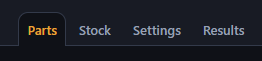
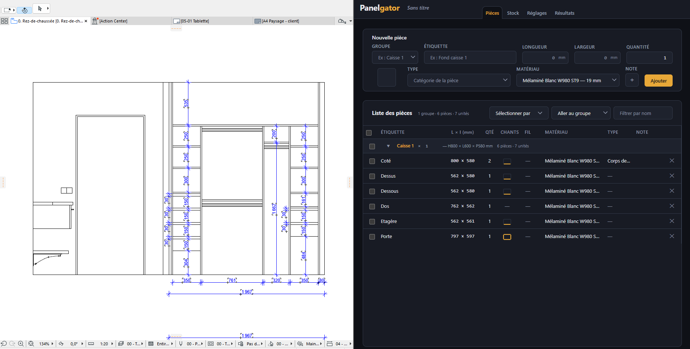
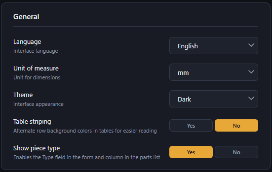

# Premier lancement

## La fenêtre principale

La fenêtre est organisée autour de **4 onglets** :

1. **Pièces** — Table de vos pièces et groupes
2. **Stock** — Table des panneaux disponibles
3. **Réglages** — Paramètres de coupe et préférences utilisateur
4. **Résultats** — Visualisation des résultats et accès aux exports

> [!TIP]
> **Naviguer entre les onglets**
>
> - **Clic** sur l'onglet
> - <kbd>Ctrl</kbd>+<kbd>1</kbd> à <kbd>Ctrl</kbd>+<kbd>4</kbd>

Panelgator est optimisé pour travailler en **fenêtre réduite** si vous n'avez qu'un seul écran à disposition.

## Configuration initiale recommandée

Avant de créer votre premier projet, prenez 30 secondes pour configurer Panelgator selon vos préférences. Ouvrez l'onglet **Réglages > Général** :

### Langue

Français ou anglais. La modification s'applique immédiatement à toute l'interface.

### Unités

**Millimètres** (par défaut), **centimètres** ou **pouces**.

### Thème

**Clair**, **Sombre**, ou **Système** (suit votre préférence Windows). Choisissez ce qui vous convient le mieux pour votre atelier ou bureau.

Ces préférences sont **globales à votre poste** (pas par projet). Elles sont conservées entre les sessions.

## À lire ensuite

- [Tutoriel : Premier projet en 5 minutes](../01-demarrer/04-tutoriel.md) — créer votre premier débit
- [Concepts : Pièces, groupes et dimensions](../02-concepts/01-projet-groupe-pieces.md) — comprendre le modèle de données
