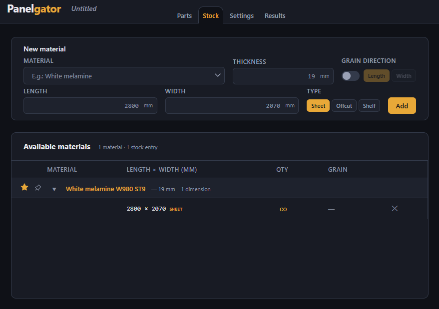
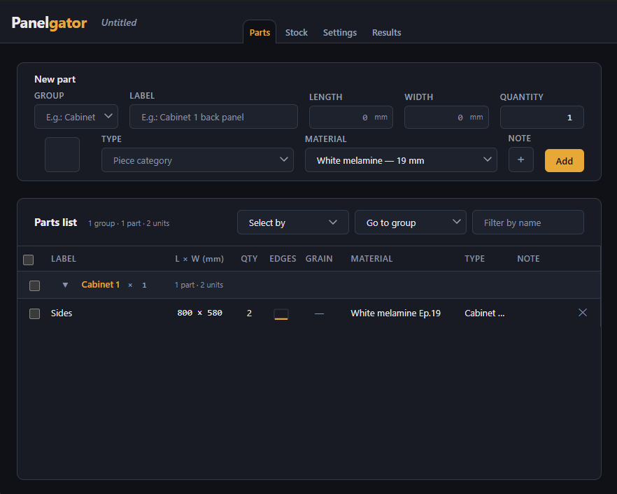
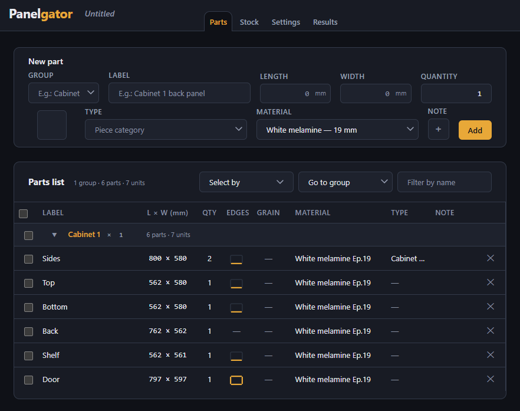
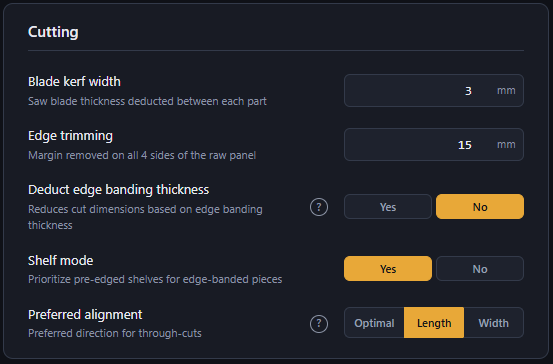
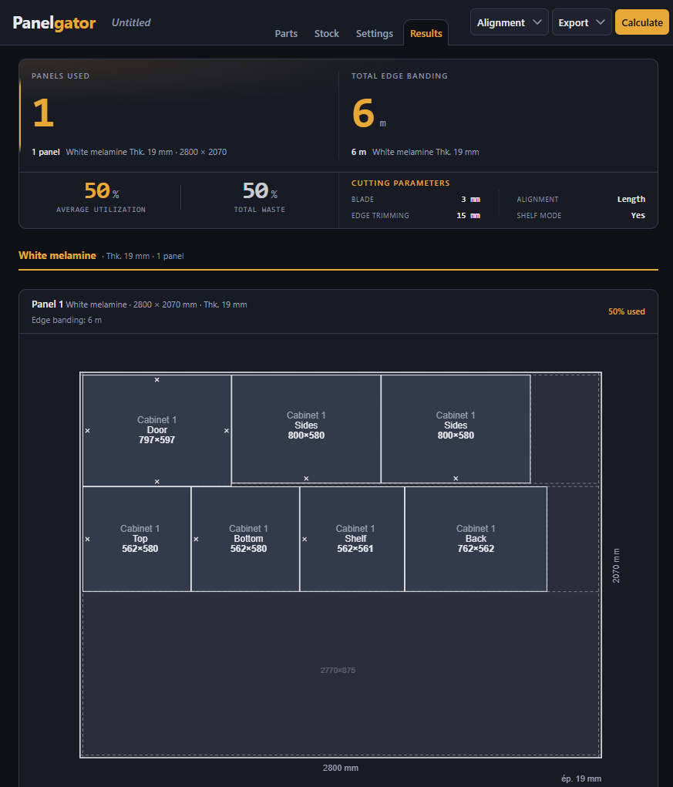
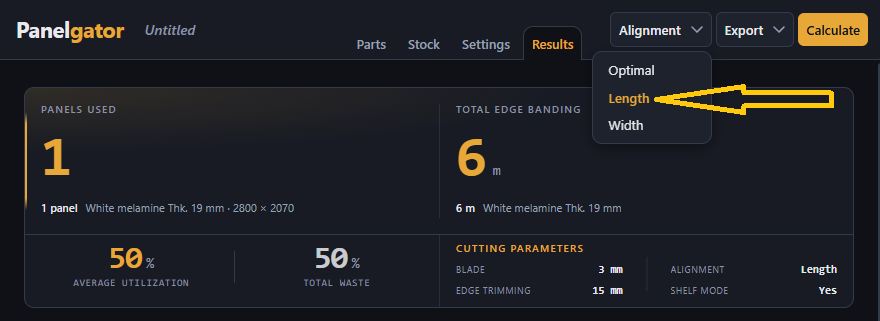
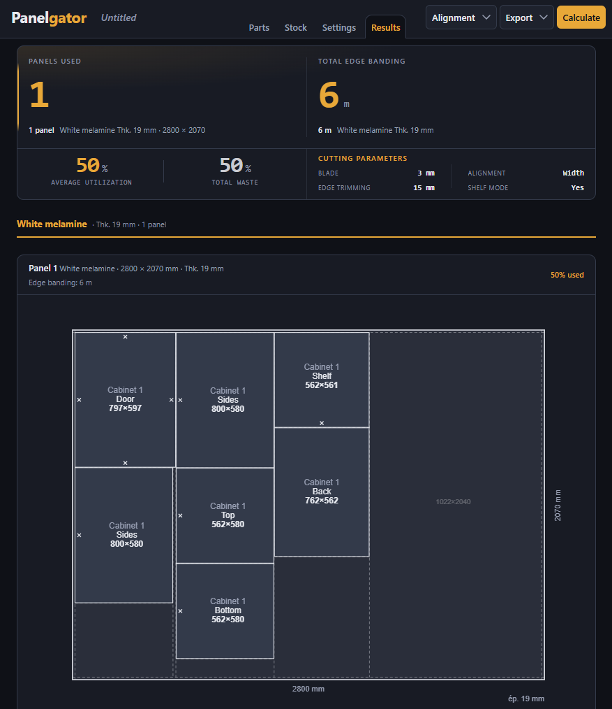
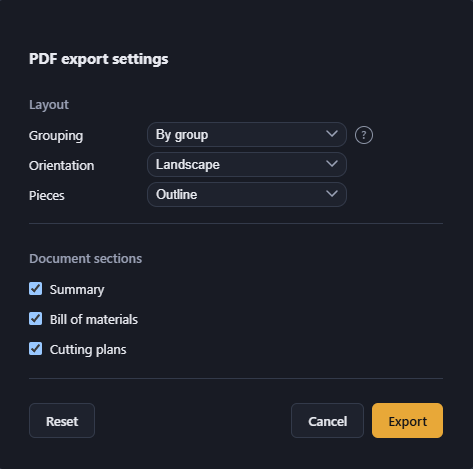

# Tutoriel : premier projet en 5 minutes

Ce tutoriel vous guide à travers la création d'un projet simple pour une première prise en main : un **caisson** simple, en mélaminé blanc 19 mm. À la fin, vous aurez un calepinage complet et un PDF prêt à imprimer pour l'atelier.

Comptez environ **5 minutes**.

## Ce que nous allons faire

Nous allons fabriquer un caisson standard, dimensions extérieures **800 × 600 × 580 mm** (hauteur × largeur × profondeur), avec :

- 2 **côtés** verticaux
- 1 **dessus**
- 1 **dessous**
- 1 **dos** en panneau de 19 mm (pour cet exemple, nous simplifions : pas de fond fin)
- 1 **étagère** réglable
- 1 **porte**

Soit **7 pièces** au total.

## Étape 1 — Configurer le matériau

Avant de saisir les pièces, il faut déclarer le panneau dont nous disposons. Cliquez sur l'onglet **Stock** (ou <kbd>Ctrl</kbd>+<kbd>2</kbd>).

### Créer le matériau

Dans le formulaire **Nouveau matériau** en haut, saisissez :

1. **Matériau** : `Mélaminé blanc W980 ST9`
2. **Épaisseur** : `19` mm
3. **Longueur** : `2800` mm
4. **Largeur** : `2070` mm
5. **Type** : sélectionnez `Entier`
6. Cliquez sur **Ajouter**

## Étape 2 — Créer le groupe « Caisse 1 » et saisir la première pièce

Passez à l'onglet **Pièces** (<kbd>Ctrl</kbd>+<kbd>1</kbd>).

Dans le formulaire **Nouvelle pièce** en haut, saisissez :

1. **Groupe** : `Caisse 1` — le nouveau groupe est créé et les champs *Dimensions du groupe* apparaissent (facultatifs).
2. **Dimensions du groupe** : Hauteur `800` mm, Largeur `600` mm, Profondeur `580` mm
3. **Étiquette** : `Côté`
4. **Longueur** : `800` mm
5. **Largeur** : `580` mm
6. **Quantité** : `2`
7. **Chant** : ajoutez le chant avant en cliquant sur la longueur `800` — le chant actif apparaît en doré
8. **Matériau** : sélectionnez `Mélaminé blanc W980 ST9 — 19 mm`
9. Cliquez sur **Ajouter**

Le groupe apparaît maintenant dans la liste des pièces et contient nos deux côtés.

## Étape 3 — Saisir toutes les pièces

Ajoutez maintenant les autres pièces depuis le formulaire **Nouvelle pièce**. Le sélecteur *Groupe* reste positionné sur le dernier groupe créé, pour enchaîner la saisie plus rapidement.

> [!TIP]
> **Raccourcis clavier utiles**
>
> - <kbd>Tab</kbd> ou <kbd>Entrée</kbd> — naviguer entre les champs sans la souris
> - <kbd>Ctrl</kbd>+<kbd>Entrée</kbd> — soumettre le formulaire directement
> - <kbd>←</kbd> <kbd>↑</kbd> <kbd>↓</kbd> <kbd>→</kbd> — assigner les chants individuellement ; <kbd>Espace</kbd> bascule Tous / Aucun
> - Expressions mathématiques (`600-2*19`, `+`, `-`, `*`, `/`) acceptées directement dans les champs numériques

| Étiquette | Longueur | Largeur | Quantité | Chant | Matériau             |
|-----------|---------:|--------:|:--------:|-------|----------------------|
| Dessus    |      562 |     580 |        1 | avant | Mélaminé blanc 19 mm |
| Dessous   |      562 |     580 |        1 | avant | Mélaminé blanc 19 mm |
| Dos       |      762 |     562 |        1 | —     | Mélaminé blanc 19 mm |
| Étagère   |      562 |     561 |        1 | avant | Mélaminé blanc 19 mm |
| Porte     |      797 |     597 |        1 | tous  | Mélaminé blanc 19 mm |

## Étape 4 — Vérifier les réglages

Cliquez sur **Réglages** (<kbd>Ctrl</kbd>+<kbd>3</kbd>).

Pour ce premier projet :

- **Alignement préféré** : *Longueur*
- **Trait de scie** : `4` mm (typique pour scie circulaire d'atelier)
- **Rééquerrage** : `15` mm sur 4 côtés des panneaux entiers

Vous pouvez ajuster ces valeurs plus tard selon votre outillage et vos habitudes.

## Étape 5 — Lancer le calepinage

Changez d'onglet vers **Résultats** (<kbd>Ctrl</kbd>+<kbd>4</kbd>), puis cliquez sur le bouton **Calculer** en haut à droite.

## Étape 6 — Visualiser les résultats

Vous trouverez en haut :

- Le nombre de panneaux utilisés
- Les longueurs de chants utilisés
- Les % d'utilisation et de chute
- Le rappel des paramètres de coupe

Et plus bas le plan de coupe du panneau :

Chaque pièce dans le plan de coupe porte son groupe, son étiquette, ses dimensions (longueur × largeur), et ses chants plaqués signalés par la marque **X**.

> [!TIP]
> **Navigation dans le plan de coupe**
>
> - **Zoomer** : <kbd>Ctrl</kbd> + molette
> - **Déplacer la vue** : clic-glissé
> - **Réinitialiser le zoom** : double-clic

Vous pouvez changer la préférence d'alignement via le menu **Alignement** en haut à droite. Sélectionnez *Largeur* — le plan est réorganisé sans nouveau calcul.

## Étape 7 — Exporter en PDF

C'est le document que vous emporterez à l'atelier.

1. Toujours dans l'onglet **Résultats**, ouvrez le menu **Exporter** puis choisissez **PDF**
2. Une modale s'ouvre avec les différentes options de mise en page
3. Gardez les valeurs par défaut pour notre exemple (toutes les options détaillées dans <!-- LINK_DISABLED: ../../08-exports/02-pdf/ -->Export PDF)
4. Cliquez sur **Exporter**
5. Choisissez l'emplacement de sauvegarde

## Étape 8 — Sauvegarder le projet

<kbd>Ctrl</kbd>+<kbd>S</kbd>, ou **Fichier > Enregistrer sous**, pour enregistrer le projet en fichier `.pnlg`. Choisissez un nom (par exemple `tutoriel.pnlg`) et un emplacement.

À tout moment, vous pourrez rouvrir ce projet pour le modifier.

## Et après ?

Bravo, vous avez fait le tour des fonctionnalités essentielles. Pour aller plus loin :

- **Importer une liste de pièces** — voir <!-- LINK_DISABLED: ../../07-imports/01-bxf2/ -->Import BXF2 ou <!-- LINK_DISABLED: ../../07-imports/02-csv/ -->Import CSV
- **Configurer le sens du fil et les chants** sur du mélaminé décoratif — voir [Sens du fil et chants](../02-concepts/03-fil-chants.md)
- **Comprendre les réglages avancés** (mode tablette, déduction d'épaisseur de chant) — voir <!-- LINK_DISABLED: ../../05-onglet-reglages/ -->Onglet Réglages
- **Exporter en DXF** pour l'atelier numérique — voir <!-- LINK_DISABLED: ../../08-exports/03-dxf/ -->Export DXF

Bon débit !
