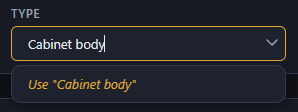
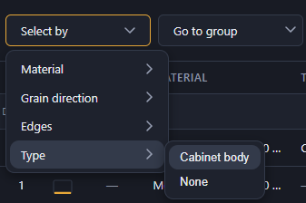

# Types de pièces

Le **type** est un attribut optionnel des pièces : un simple texte libre (« Corps », « Façade », « Tiroir », « Plinthe »…) qui sert à étiqueter, filtrer et regrouper.

Contrairement au [groupe](../02-concepts/01-projet-groupe-pieces.md) qui rassemble physiquement les pièces d'un même meuble, le type est **transversal**. Un type « Façade » peut appartenir à plusieurs groupes (Caisson A, Caisson B, Colonne…).

## D'où viennent les types ?

Les types sont alimentés par trois canaux.

### Saisie manuelle

Dans le formulaire pièce, le champ **Type** fonctionne comme le champ **Groupe**. Si aucun type n'existe encore, vous pouvez taper directement ce que vous souhaitez et créer ainsi un nouveau type.

Une valeur de type, une fois créée, est portée par les pièces qui la référencent. Elle disparaît automatiquement de la liste d'autocomplétion quand plus aucune pièce ne la porte.

> [!TIP]
> Vous pouvez corriger un type tout de suite après l'avoir créé via **Menu > Édition > Annuler** ou <kbd>Ctrl</kbd>+<kbd>Z</kbd>.

> [!NOTE]
> Il n'y a pas de référentiel de types prédéfini. La liste qui apparaît dans l'autocomplétion est purement **dérivée** des pièces de votre projet en cours : ouvrir un nouveau projet repart d'une liste vide.

### Import BXF2

Les pièces importées sont regroupées en **4 catégories** :

- **Corps de meuble** — côtés, dessus, dessous, dos, etc.
- **Façades** — portes, bandeaux, faces de tiroir
- **Tiroirs** — côtés, dos, fonds
- **Autres** — modèles non reconnus

Chaque pièce importée reçoit le type correspondant. Voir <!-- LINK_DISABLED: ../../07-imports/03-mapping/#mapping-en-4-cat%C3%A9gories -->Mapping et types de pièces pour le tableau complet.

### Import CSV

Le champ **Type** de votre <!-- LINK_DISABLED: ../../07-imports/02-csv/ -->import CSV est repris tel quel. Toute valeur texte est acceptée — vous pouvez utiliser vos propres conventions (« Plinthe », « Joue visible », « Habillage »…).

## À quoi ça sert ?

### Filtrer et sélectionner

Le bouton **Sélectionner par > Type** dans la liste de pièces affiche toutes les valeurs présentes dans le projet. Cliquer sur l'une d'elles coche d'un coup toutes les pièces correspondantes pour leur appliquer une <!-- LINK_DISABLED: ../../03-onglet-pieces/04-actions-masse/ -->action en masse.

Exemple concret : sélectionner toutes les pièces portant le type **Corps de meuble** et leur attribuer le matériau « Mélaminé blanc W980 ST9 — 19 mm ».

### Grouper le PDF par type

À l'export PDF (récapitulatif), l'option *Groupement* propose **Par type de pièce** : un tableau par catégorie, sous-trié par groupe.

### Affecter un type à plusieurs pièces

Une fois plusieurs pièces sélectionnées, vous pouvez leur **assigner un type commun** depuis la barre de sélection : tapez la valeur dans le champ Type ou choisissez une valeur existante dans le menu déroulant.

## Activer l'affichage du type

L'affichage du type dans le formulaire de pièce et dans la liste est piloté par le réglage **Réglages > Général > Afficher le type de pièce** (désactivé par défaut). Activez-le si vous travaillez avec des imports BXF2 ou si vous souhaitez catégoriser manuellement.

> [!TIP]
> Même si l'affichage du type est désactivé, les types des pièces sont **conservés en interne**. Si vous activez l'affichage plus tard, vous retrouverez toutes les valeurs.

## Bon à savoir

- Le type est **purement textuel** : la casse et les espaces comptent (« Façade » et « façade » sont deux types distincts).
- Le type **n'influence pas** l'algorithme de calepinage — il n'a qu'un rôle de filtrage et d'organisation.
- Si vous voulez normaliser vos types (par exemple unifier « Facade » et « Façade »), passez par **Sélectionner par > Type** puis affectez en masse la valeur cible.

## À lire ensuite

- [Projet, groupe, pièces](../02-concepts/01-projet-groupe-pieces.md) — la structure du projet
- [Sens du fil et chants](../02-concepts/03-fil-chants.md) — l'orientation du veinage
