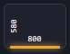

# Sens du fil et chants

Deux notions liées au métier de l'agencement influencent fortement l'algorithme : le **sens du fil** et les **chants**. Cette page explique comment Panelgator les gère.

## Sens du fil

Le sens du fil correspond à l'orientation du veinage du bois (ou du décor sur un panneau mélaminé). Quand le fil est défini sur un matériau, Panelgator garantit que toutes les pièces du même matériau auront un veinage cohérent.

### Sur le matériau (Stock)

Au niveau du **Stock**, vous indiquez si le matériau a un sens du fil :

- **Aucun** — le panneau est isotrope (mélaminé blanc uni, MDF brut, etc.). Panelgator peut faire pivoter les pièces librement pour optimiser le calepinage.
- **Longueur** — le veinage suit l'axe long du panneau (cas classique des panneaux mélaminés décoratifs)
- **Largeur** — le veinage suit l'axe court (rare, mais possible sur certaines essences ou chute)

### Sur la pièce

Au niveau de chaque **pièce**, vous indiquez la direction du fil souhaitée par rapport à la pièce :

- **Aucun** — la pièce n'a pas de contrainte de fil (par défaut quand le matériau n'a pas de fil)
- **Longueur** — le fil suit la longueur de la pièce
- **Largeur** — le fil suit la largeur de la pièce

Quand le matériau a un fil défini, Panelgator place les pièces sur le panneau dans la bonne orientation pour respecter cette contrainte.

> [!NOTE]
> Si une pièce ne peut pas être placée à cause de la contrainte de fil (par exemple, pièce plus grande que le panneau dans la dimension imposée par le fil), elle sera signalée comme **non plaçable** dans la vue Résultats.

## Suivi de fil (Liaisons)

Vous avez la possibilité de lier plusieurs pièces ensemble afin de faire suivre le veinage entre elles. 

Exemple : Un caisson avec 3 tiroirs alignés verticalement (typiquement un casserolier), le veinage doit se prolonger d'une façade à la suivante pour donner l'impression d'un seul panneau coupé en plusieurs morceaux.

Au moment du calcul, l'algorithme placera ces pièces **adjacentes** sur le même panneau, dans l'ordre que vous avez défini pour préserver la continuité du veinage.

Une chaîne peut être brisée par l'algorithme si elle ne tient pas sur un panneau (dimensions cumulées trop grandes).

<!-- LINK_DISABLED: ../../03-onglet-pieces/03-suivi-fil/ -->Voir suivi de fil

## Chants plaqués

Un chant plaqué est une **bande de finition** collée sur le bord d'un panneau pour cacher le cœur du matériau et donner un aspect fini.
Les chants plaqués sont visibles sur le plan de coupe dans **résultats** et sur les **exports**.

### Sélection des chants

Pour chaque pièce, vous indiquez quels côtés sont chantés. Panelgator utilise un sélecteur visuel à 4 cases (haut, droite, bas, gauche). Cliquez sur chaque côté pour activer ou désactiver le chant.

Les côtés chantés apparaissent en doré dans le sélecteur.

> [!TIP]
> Utilisez les touches <kbd>←</kbd> <kbd>↑</kbd> <kbd>↓</kbd> <kbd>→</kbd> ou <kbd>Espace</kbd> dans le **sélecteur** pour assigner les chants sans utiliser la souris.

### Conséquences sur le calepinage

Les chants plaqués ont deux impacts importants :

#### 1. Mode tablette

Si vous utilisez des **tablettes** (panneaux pré-plaqués sur une longueur — voir [Stock](../02-concepts/04-stock.md)), Panelgator tente de placer en priorité les pièces avec un chant sur des tablettes plutôt que sur des panneaux entiers et place le chant contre le bord déjà plaqué de la tablette. 

#### 2. Déduction de l'épaisseur du chant

Si l'option **Déduire l'épaisseur du chant** est activée (Onglet Réglages > Découpe), Panelgator retire l'épaisseur du chant des dimensions de coupe pour chaque côté chanté.
Les rendus de coupe affichent la dimension déduite ( plan de coupe), les documents affichent la dimension finie (liste de débit, étiquettes). 

## Bon à savoir

- Le **sens du fil** et les **chants** sont totalement indépendants. Vous pouvez avoir une pièce avec fil mais sans chant, ou avec chant mais sans fil, ou les deux, ou aucun.

## À lire ensuite

- [Stock et matériaux](../02-concepts/04-stock.md) — où définir les matériaux avec ou sans fil, et les types de panneaux
- [Alignement et trait de scie](../02-concepts/05-alignement.md) — autres réglages qui influent sur le calepinage
- <!-- LINK_DISABLED: ../../03-onglet-pieces/03-suivi-fil/ -->Onglet Pièces — détail de la création d'une chaîne de suivi de fil
