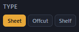
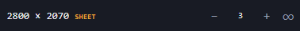
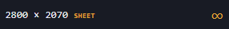

# Stock et matériaux

Le **Stock** est l'ensemble des matériaux disponibles au sein d'un projet.
Chaque **matériau** contient des **entrées de stock**.
```
Stock du projet « Cuisine Dupont »
├──  « Mélaminé blanc W980 ST9 — 19 mm »  
│   ├── Entier      2800 × 2070   × 5          
│   ├── Tablette    2800 x 560    × ∞     
│   └── Chute       1500 × 1220   × 1
│
├──  « Mélaminé blanc W980 ST9 — 16 mm »             
│   ├── Entier      2500 × 1250   × 3
│
└──  « Mélaminé Chêne naturel H1318 ST10 — 19mm »                        
    └── Entier      2800 × 2070   × 2    
```
## Matériau

Le matériau est la définition. Il contient :

- **Nom** (étiquette libre) — par exemple *Mélaminé blanc W980 ST9*
- **Épaisseur** — par exemple *19 mm*
- **Sens du fil** — *aucun, longueur, largeur*

Un même matériau peut contenir plusieurs types d'entrées de stock et de dimensions différentes 

## Types d'entrée de stock



### Entier

Un panneau brut, jamais entamé. Le <!-- LINK_DISABLED: ../../05-onglet-reglages/02-decoupe/#r%C3%A9%C3%A9querrage -->rééquerrage (marge retirée des bords) s'applique aux **4 côtés**.

### Chute

Un panneau déjà entamé, conservé d'un précédent débit. Les chutes sont également rééquerrées sur **4 côtés**.
Si une chute est disponible l'algorithme l'utilise en **priorité** avant d'ouvrir un nouveau panneau entier.

### Tablette

Un panneau ou bande pré-plaqué sur une longueur, typiquement *tablette mélaminé*, *plan de travail*, avec un chant déjà collé d'un côté. 
Les tablettes ne sont rééquerrées que sur **2 côtés** (les extrémités), car le bord plaqué et son opposé sont considérés finis.

Quand le <!-- LINK_DISABLED: ../../05-onglet-reglages/02-decoupe/#mode-tablette -->mode tablette est activé (Onglet Réglages), l'algorithme place en priorité les pièces ayant au moins un chant sur des tablettes et place le chant de la pièce le long du bord pré-plaqué. 

En revanche l'algorithme évite de placer des pièces sans chant sur des tablettes.

> [!TIP]
> Vous pouvez utiliser les caractéristiques du **mode tablette** pour calepiner n'importe quel **matériau en barre**.
>
> Exemple : bois d'ossature, profilés aluminium, tube d'acier...etc...
>
> Les pièces doivent obligatoirement avoir un chant plaqué pour être acceptées sur une entrée de stock **tablette**

### Ordre de priorité

En résumé l'algorithme distribue les pièces de la manière suivante :

1. En priorité sur les **chutes** ( si disponibles )

2. En priorité sur les **tablettes** ( si disponibles et la pièce possède 1 chant compatible )

3. Sur les **entiers**


## Quantité

Pour chaque entrée de stock, vous indiquez la quantité disponible :

### Limitée



Un nombre fini de panneaux. Panelgator s'arrête à cette quantité et marque les pièces qui ne tiennent pas comme **non plaçables**.

### Illimitée



Panelgator peut utiliser autant de panneaux que nécessaire. Idéal quand vous souhaitez connaître la quantité nécessaire pour votre projet.


## Matériau favori ⭐

Vous pouvez désigner **un matériau favori** en cliquant sur l'étoile à côté de son nom. Le matériau favori a deux rôles :

1. Il est **présélectionné** dans le formulaire **nouvelle pièce** pour accélérer la saisie
2. Il est utilisé pour les pièces importées qui n'ont pas de matériau mappé

L'étoile est dorée pour le matériau favori, grise pour les autres.


## Stock permanent 📌

Pour les matériaux que vous utilisez souvent, vous pouvez les **épingler** en cliquant sur l'icône épingle.

Un matériau épinglé est conservé entre les projets. Quand vous créez un nouveau projet, votre stock épinglé est déjà là sans avoir à le resaisir.

L'épingle apparaît en doré pour les matériaux permanents.


## Bon à savoir

- Vous pouvez **collapser/déployer** chaque matériau dans la liste pour faire de la place visuelle quand vous avez beaucoup d'entrées
- Un matériau ne peut pas être **supprimé** s'il a au moins une pièce qui l'utilise. Réassignez d'abord les pièces ailleurs avant de supprimer.
- Les chutes que vous générez peuvent être réinjectées dans un **prochain** projet en les ajoutant manuellement avec le type *Chute*. Panelgator ne fait pas le suivi automatique entre projets.

## À lire ensuite

- [Sens du fil et chants](../02-concepts/03-fil-chants.md) — comment marquer un matériau comme ayant du fil
- [Alignement et trait de scie](../02-concepts/05-alignement.md) — les autres réglages qui influent sur le calepinage
- <!-- LINK_DISABLED: ../../04-onglet-stock/ -->Onglet Stock — la fiche détaillée de l'interface
